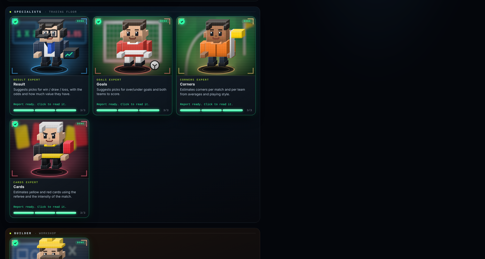
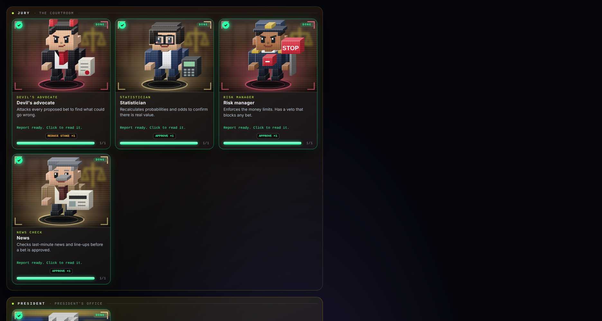
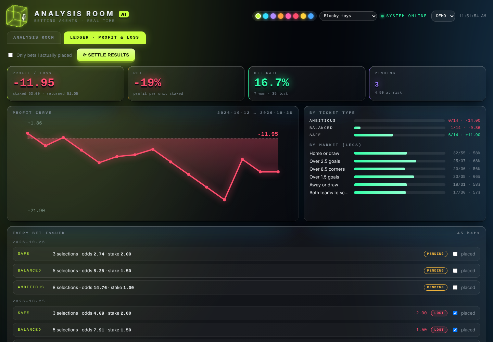

# Bets Agents

**A team of 18 AI agents (built on [Claude Code](https://claude.com/claude-code)) that analyses today's football matches and proposes the day's accumulator bets, with a jury that can veto and a president who signs off.**

> **Not financial advice. No profit is promised.** All probabilities are estimates. Nothing here places a bet for you; you place it yourself, at your own bookmaker, within limits you set. Gambling can be addictive: set limits and never chase losses.

## Run it in 60 seconds

Requirements: [Claude Code](https://claude.com/claude-code) (logged in) and Python 3.

```bash
git clone https://github.com/JoaoAntunesss/Bets-Agents.git
cd Bets-Agents
python scripts/dashboard.py     # opens http://localhost:8765
```

In the dashboard click **◈ VIEW DEMO** to preview it for free, or **▶ START ANALYSIS** to run the real thing (full day or a single match). Prefer the terminal?

```bash
claude          # then type:  /today
```

- One match only: `/today Benfica vs Porto`
- Result: `matches/YYYY-MM-DD/decision.md`
- Edit `limits.md` first: stake, daily risk, timezone, mode.

## How it works

One slash command, `/today`, runs a five-phase pipeline over every match of the major leagues that has not started yet:

1. **Collection**: 8 specialists per match: team analyst, historian, referee, meteorologist, stadium, medic (injuries/suspensions), reporter (news) and player form.
2. **Market specialists**: result, goals, corners, cards. Each turns the reports into candidate selections with an honest probability.
3. **Builder**: assembles **three accumulators every day**: safe, balanced and ambitious (the last one aims at a €200+ payout and is clearly labelled a long shot).
4. **Jury** (4 members): devil's advocate, statistician, risk manager (with veto) and a news-checker.
5. **President**: reads everything and writes the final `decision.md`, with the three main reasons behind each selection and the combined probability of each ticket.

Rules baked into the prompts: phases cannot be skipped, matches that already started are discarded, missing real odds are replaced by *estimated* odds clearly marked "confirm at your bookmaker", agents never invent numbers ("no data" instead), and the money limits in `limits.md` can never be exceeded.

## Dashboard ("Analysis Room")

A local, dependency-free dashboard shows the agents working in real time. Every agent is a small blocky character in a themed room: scouting department, trading floor, workshop, courtroom and president's office. Cards explain in plain language what each agent does and show a live status line, a live ticker, the progress of each phase, the jury votes, the president's decision and a bet slip of the proposals. Click any card to read its report.

- **Themes and styles:** pick an accent colour and a character style (blocky toys, mascot, pop figure, sticker, holo, portrait, champion) in the header.
- **Ledger tab:** every bet ever issued, marked as won, lost or pending, with profit/loss, ROI, hit rate, a profit curve and breakdowns by ticket type and market. Tick "placed" on the bets you really made.
- **Your own art:** drop `scripts/avatars/<agent-id>.png` to replace a figure (prompts in `docs/`).
- **Demo mode:** the "Demo" button runs the whole thing with fictional data.





*Screenshots use the built-in demo mode (fictional data, no cost, no real bets).*

## Settling bets

After the matches, run `/settle` (or press "Settle results" in the Ledger tab). `scripts/results.py` fetches final scores, the `settler` agent marks each leg won/lost/void, and `scripts/ledger.py` computes the totals. Untested against real runs so far, so check the first results by hand.

## Project layout

| Path | What it is |
| --- | --- |
| `CLAUDE.md` | The coordinator's workflow and hard rules |
| `limits.md` | Stake, daily risk, timezone, ticket shapes (defaults, edit before use) |
| `.claude/agents/` | The 19 agents: 8 collectors, 4 market specialists, builder, 4 jury members, president, settler |
| `.claude/commands/today.md`, `settle.md` | The `/today` and `/settle` commands |
| `scripts/fixtures_today.py` | Lists today's fixtures (ESPN, no API key) |
| `scripts/dashboard.py`, `dashboard.html` | The local dashboard |
| `scripts/ledger.py`, `results.py` | Profit/loss maths and final-score fetching |
| `scripts/avatars/` | Optional custom character images |
| `matches/` | Daily output (git-ignored) |

## Tips and limits

- Without API keys the agents rely on web search, so the quality of odds and stats varies. For more reliability, plug in API-Football and The Odds API.
- A full day uses a lot of Claude Code usage. Collection agents run on Haiku and the rest on Sonnet to save quota; run a single match first.
- **Start by simulating** for 2 to 4 weeks: write the bets down without money and check whether the analysis has any real value.
