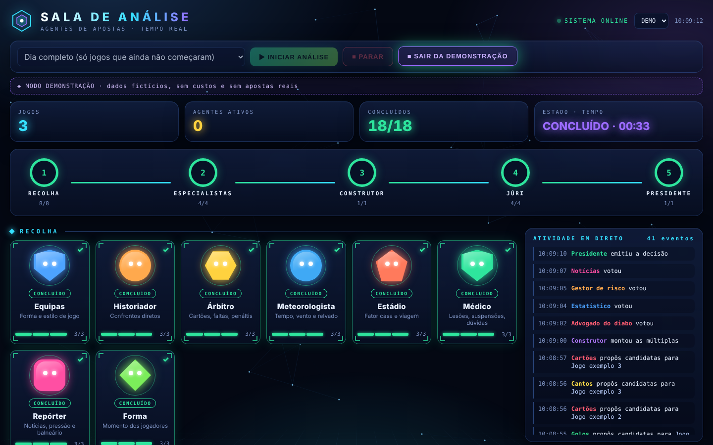

# Bets Agents

**A team of AI agents (built on [Claude Code](https://claude.com/claude-code)) that analyses today's football matches and proposes the day's accumulator bets, with a jury that can veto and a president who signs off.**

> Portuguese version: [README.pt.md](README.pt.md). The agent prompts are written in Portuguese.

> **Not financial advice. No profit is promised.** All probabilities are estimates. Nothing here places a bet for you; you place it yourself, at your own bookmaker, within limits you set. Gambling can be addictive: set limits and never chase losses. In Portugal, SICAD support line: 1414.

## How it works

One slash command, `/dia`, runs a five-phase pipeline over every match of the major leagues that has not started yet:

1. **Collection**: 8 specialists per match: team analyst, historian, referee, meteorologist, stadium, medic (injuries/suspensions), reporter (news), and player form.
2. **Market specialists**: result, goals, corners, cards. Each turns the reports into candidate selections with an honest probability.
3. **Builder**: assembles **three accumulators every day**: safe, balanced and ambitious (the last one aims at a €200+ payout and is clearly labelled as a long shot).
4. **Jury** (4 members): devil's advocate, statistician, risk manager (with veto), and a news-checker.
5. **President**: reads everything and writes the final `decision.md`, with the three main reasons behind each selection and the combined probability of each ticket.

Rules baked into the prompts: phases cannot be skipped, matches that already started are discarded, missing real odds are replaced by *estimated* odds clearly marked "confirm at your bookmaker", agents never invent numbers ("sem dados" instead), and the daily money limits in `limites.md` can never be exceeded.

## Dashboard ("Sala de Análise")

A local, dependency-free dashboard shows the agents working in real time, the progress of each phase, the jury votes and the president's decision. It has Start/Stop buttons, so you don't need to type `/dia` by hand.




*Screenshots use the built-in demo mode (fictional data, no cost, no real bets).*

## Quick start

Requirements: [Claude Code](https://claude.com/claude-code) and Python 3.

```bash
git clone https://github.com/JoaoAntunesss/Bets-Agents.git
cd Bets-Agents
# edit limites.md: stake, daily risk and mode
claude          # then type:  /dia
```

- One match only: `/dia Benfica vs Porto`
- Dashboard (second terminal): `python scripts/dashboard.py` and open <http://localhost:8765>; use **Ver demonstração** to preview it for free.
- Read the result in `jogos/YYYY-MM-DD/decisao.md`.

## Project layout

| Path | What it is |
| --- | --- |
| `CLAUDE.md` | The coordinator's workflow and hard rules |
| `limites.md` | Stake, daily risk, ticket shapes (default values, edit before use) |
| `.claude/agents/` | The 18 agents: 8 collectors, 4 market specialists, builder, 4 jury members, president |
| `.claude/commands/dia.md` | The `/dia` command |
| `scripts/jogos_hoje.py` | Lists today's fixtures (no API key) |
| `scripts/dashboard.py`, `dashboard.html` | The local dashboard |
| `jogos/` | Daily output (git-ignored) |

## Tips and limits

- Without API keys the agents rely on web search, so the quality of odds and stats varies. For more reliability, plug in API-Football and The Odds API.
- A full day uses a lot of Claude Code usage. Collection agents run on Haiku and the rest on Sonnet to save quota; run a single match first.
- **Start by simulating** for 2 to 4 weeks: write the bets down without money and check whether the analysis has any real value.
